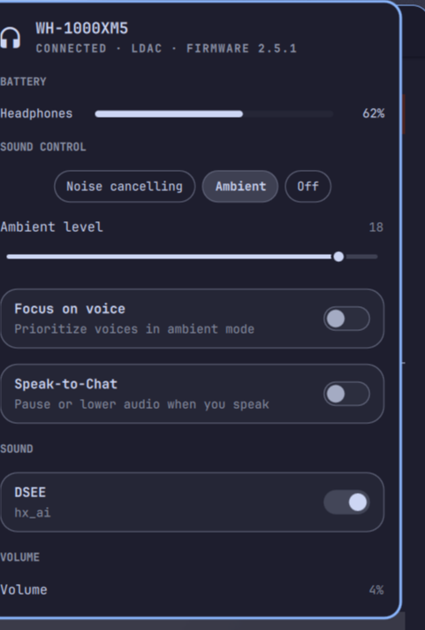

# Sony Headphones for Linux

A fast, native Linux service and CLI for Sony headphones that use the Sony | Sound Connect protocol. It publishes live headphone state as a standard JSON file and accepts commands over a private Unix socket, so any desktop environment, status bar, script, or automation tool can read and control the headphones. An included Omarchy Quattro bar widget provides a ready-made graphical interface.

It is designed around the WH-1000XM5, but discovers protocol capabilities at runtime so the same code can serve compatible WH, WF, WI, LinkBuds, ULT, and INZONE families without a hard-coded UI per model.

The project is a hardware alpha. Its complete local control path has been tested on one WH-1000XM5 running firmware 2.5.1, including reversible writes and RFCOMM release/reconnect. That evidence does not imply that every Sound Connect model is tested. See [TASKS.md](TASKS.md) and the [compatibility matrix](docs/COMPATIBILITY.md).

| Omarchy dark theme | Omarchy light theme |
| --- | --- |
|  |  |

The included Omarchy panel follows Omarchy's live palette and control tokens. The daemon and CLI work independently on any Linux desktop.

## Current control surface

- Main, left, right, and case battery where reported
- Noise cancellation, ambient sound level, and focus on voice
- Speak-to-Chat
- DSEE and equalizer presets only when the daemon reports the writable preset list
- Headphone volume, normalized from Sony's 31 hardware levels to a `0–100` percentage
- Connection quality/stability preference

Controls are capability-gated. A device that does not report a feature does not receive a dead toggle.

Action buttons are centered in responsive rows, and the sound-control modes pair clear icons with their labels. The deliberately compact panel keeps native text and control sizing and scrolls when its lower sections exceed the available height. It follows Omarchy's keyboard model: Up/Down moves between control groups, Left/Right moves within a button row or adjusts a slider, Enter/Space activates the current control, Escape closes, and Tab/Shift+Tab switches neighboring bar panels. Transport playback buttons are intentionally not shown.

Adaptive ambient tuning, custom EQ bands/Clear Bass, multipoint management, auto-off, wearing/auto-pause, assignable controls, voice guidance, pairing, and shutdown remain planned and are tracked in [TASKS.md](TASKS.md).

## Integration

The daemon and CLI are standalone Linux programs with no desktop-environment dependency. Any tool that can read a JSON file or run a shell command can integrate.

### Status file

The daemon atomically publishes state to:

```text
${XDG_STATE_HOME:-$HOME/.local/state}/sony-headphones/status.json
```

Watch it with `inotifywait`, poll it, or read it once. The JSON includes device identity, battery levels, noise mode, volume, EQ, capabilities, and connection phase.

### CLI commands

`sony-headphonesctl` validates and sends one command per invocation:

```text
sony-headphonesctl status
sony-headphonesctl noise off|anc|ambient
sony-headphonesctl ambient-level 1..20
sony-headphonesctl focus-on-voice on|off
sony-headphonesctl speak-to-chat on|off
sony-headphonesctl dsee on|off
sony-headphonesctl eq-preset <preset>
sony-headphonesctl connection quality|stable
sony-headphonesctl volume 0..100
sony-headphonesctl playback play|pause|next|previous
```

### Quick examples

**Waybar** custom module:

```jsonc
"custom/sony": {
    "exec": "cat ~/.local/state/sony-headphones/status.json",
    "return-type": "json",
    "interval": 3,
    "on-click": "sony-headphonesctl noise anc"
}
```

**Polybar** script module:

```ini
[module/sony]
type = custom/script
exec = jq -r '"󰋋 " + (.battery.main.level|tostring) + "% [" + .noise.mode + "]"' ~/.local/state/sony-headphones/status.json
interval = 3
click-left = sony-headphonesctl noise anc
```

**Shell keybinding** (Hyprland, Sway, i3):

```text
bind = $mainMod, F9, exec, sony-headphonesctl noise anc
bind = $mainMod, F10, exec, sony-headphonesctl noise ambient
```

See the full [integration guide](docs/INTEGRATION.md) for eww, AGS, i3status-rust, KDE Plasma, GNOME Shell, Python, and more.

## Deliberately excluded

- 360 Reality Audio
- Firmware flashing or updates
- Sony account, cloud backup, activity, location, and service integrations
- Factory reset

Those functions are either outside a local desktop controller's purpose, carry unacceptable recovery risk, or depend on proprietary online services.

## Architecture

```text
Any frontend (Omarchy, Waybar, eww, scripts, …)
  watches status.json | runs sony-headphonesctl
                                   |
                          private Unix socket
                                   |
                           sony-headphonesd
                        BlueZ D-Bus + libmdr
                                   |
                            Sony headphones
```

The daemon keeps one event loop, publishes JSON atomically after changes, and opens Sony's RFCOMM control channel only while an action needs it. This limits idle work and reduces conflict with Sony's phone app. The included Omarchy QML frontend watches the same JSON file and runs the same CLI.

Read the full [architecture](docs/ARCHITECTURE.md), [specification](SPEC.md), and [integration guide](docs/INTEGRATION.md).

## Dependencies

Runtime:

- Linux with BlueZ and D-Bus
- `sony-headphonesd` and `sony-headphonesctl` built by this repository
- Omarchy Quattro/Quickshell for the included graphical plugin (optional)

Build:

- CMake 3.31 or newer (required by the pinned libmdr source)
- A C++20 compiler
- Git, `pkg-config`, and `jq`
- D-Bus development headers
- BlueZ development headers and `libbluetooth`
- Node.js only for the pure JavaScript model test

No Python runtime or build step is used. The Sony protocol dependency is built from pinned C++ source. BlueZ and D-Bus remain distribution-owned because replacing security-sensitive system integration libraries with private copies would make updates and ABI management less reliable.

Debian/Ubuntu required packages: `build-essential`, `cmake`, `git`, `pkg-config`, `jq`, `libdbus-1-dev`, `libbluetooth-dev`, `nodejs`.

Arch required packages: `base-devel`, `cmake`, `git`, `pkgconf`, `jq`, `dbus`, `bluez`, `bluez-libs`, `nodejs`.

The service and plugin never invoke administrative requests or require root permissions.

## Build on Debian now

Check the host first:

```sh
./scripts/check-deps.sh
```

Build the native core and mock backend without Bluetooth dependencies:

```sh
./scripts/build.sh --without-libmdr
./build/native/sony-headphonesd --mock
```

In another terminal:

```sh
./build/native/sony-headphonesctl status
./build/native/sony-headphonesctl noise anc
./build/native/sony-headphonesctl ambient-level 12
```

Build the real BlueZ/libmdr backend after installing the development packages:

```sh
./scripts/build.sh
```

The build script fetches exactly the libmdr commit recorded in `scripts/libmdr-version.sh`, applies the reviewed compatibility patch in `patches/`, builds it locally, and links the service. It does not install anything globally.

## Install on Omarchy

The graphical plugin and native companion have separate ownership:

- Omarchy clones the QML plugin into the current user's configuration directory.
- The prepared AUR package installs the daemon, CLI, user service, documentation, and license notices under `/usr`.

The stable `sony-headphones-linux` AUR package is available.

### AUR installation (recommended)

Use your preferred AUR helper (e.g., `yay`, `paru`) to install `sony-headphones-linux`:

```sh
# Example using yay
yay -S sony-headphones-linux
```

Start the background service:

```sh
SC="system""ctl"; $SC --user enable --now sony-headphones.service
```

(Optional) To install the Omarchy graphical widget:
```sh
omarchy plugin add https://github.com/VyomJain6904/sony-headphones-omarchy.git
omarchy plugin enable io.github.vyomjain6904.sony-headphones --section right
```

The AUR contains a source build description, not a project-supplied binary. Its immutable application, libmdr, and fmt archives are downloaded and verified by `makepkg`; the compilation stage is fully disconnected from the network.

Review the repository before enabling it. QML plugins run unsandboxed inside Omarchy's long-lived shell. The separate native service runs without root, setuid, or a broad D-Bus policy.

Confirm that both halves are healthy:

```sh
SC="system""ctl"; $SC --user status sony-headphones.service
sony-headphonesctl status
```

For the Omarchy plugin, the ID is `io.github.vyomjain6904.sony-headphones`. You can validate it via:
```sh
omarchy plugin validate "$HOME/.config/omarchy/plugins/io.github.vyomjain6904.sony-headphones"
```

### Source installation

Install the required Arch build packages listed above, clone the repository, build its pinned native dependencies, and enable it:

```sh
git clone https://github.com/VyomJain6904/sony-headphones-omarchy.git ~/.config/omarchy/plugins/io.github.vyomjain6904.sony-headphones
cd ~/.config/omarchy/plugins/io.github.vyomjain6904.sony-headphones
./scripts/build.sh
./scripts/deploy-native.sh
SC="system""ctl"; $SC --user enable --now sony-headphones.service
```

(Optional) To enable the Omarchy widget:
```sh
omarchy plugin enable io.github.vyomjain6904.sony-headphones --section right
```

`scripts/deploy-native.sh` safely detects a Git-managed plugin checkout and does not copy files over it.

## Update

For an AUR installation, update the native package with the normal Omarchy/AUR package workflow, restart the user service, and update the plugin independently:

```sh
omarchy update
SC="system""ctl"; $SC --user restart sony-headphones.service
omarchy plugin update io.github.vyomjain6904.sony-headphones
```

For a source installation, update the QML checkout and rebuild the native companion:

```sh
omarchy plugin update io.github.vyomjain6904.sony-headphones
cd "$HOME/.config/omarchy/plugins/io.github.vyomjain6904.sony-headphones"
./scripts/build.sh
./scripts/deploy-native.sh
SC="system""ctl"; $SC --user restart sony-headphones.service
```

## Uninstall

For the current source installation, run the uninstaller from the plugin checkout, move outside that checkout, and let Omarchy remove it:

```sh
cd "$HOME/.config/omarchy/plugins/io.github.vyomjain6904.sony-headphones"
./scripts/undeploy-native.sh
cd "$HOME"
omarchy plugin remove io.github.vyomjain6904.sony-headphones
```

For an AUR installation, remove the two independently owned parts:

```sh
SC="system""ctl"; $SC --user disable --now sony-headphones.service
# Remove the AUR package via your package manager
omarchy plugin remove io.github.vyomjain6904.sony-headphones
```

Both removal paths preserve the private state directory by default. Delete it only when its last status/error data is no longer wanted:

```sh
rm -r -- "$HOME/.local/state/sony-headphones"
```

### Publication requirements

- Keep the public repository, root `manifest.json`, README, MIT license, safe installation, and safe removal paths reviewable.
- Match the manifest and CMake versions to the signed SemVer tag, then validate the exact release tree.
- Submit the GitHub repository, category, tags, optional preview, and maintainer notes through the Omarchy Marketplace issue form. Automated listing validation checks the current commit, but it does not audit plugin security.
- Keep package manager ownership limited to native files under `/usr`; never make a package script write into a user's home or Omarchy plugin checkout.
- Preserve immutable dependency pins, reviewed patches, license notices, and complete runtime/build dependency documentation.
- Report compatibility only from recorded hardware evidence. A release must not broaden the WH-1000XM5 result into an all-model claim.
- Run every check in [docs/VERIFICATION.md](docs/VERIFICATION.md), test install/update/removal from a clean user account, and review all QML as unsandboxed shell code before publishing.

## Development loop

```sh
./scripts/check.sh
./scripts/qml-lint.sh
./scripts/deploy-plugin.sh
omarchy-shell shell rescanPlugins
```

Run the complete release gate on an Omarchy release host with:

```sh
./scripts/release-check.sh
```

Saved QML changes normally reload automatically. Never start another Quickshell process to test this plugin. Use Omarchy's current shell and inspect failures with:

```sh
qs log -p "$OMARCHY_PATH/shell" --tail 100
journalctl --user -u sony-headphones.service -f
```

## Safety and privacy

The plugin runs unprivileged with your user permissions. Its socket lives in `XDG_RUNTIME_DIR`, its state directory is private, and the public state file omits the Bluetooth MAC address. It makes no network requests and sends no telemetry. Review [SECURITY.md](SECURITY.md) before enabling real-device write commands.

## Project documents

- [SPEC.md](SPEC.md) — product and technical contract
- [ROADMAP.md](ROADMAP.md) — staged delivery plan
- [TASKS.md](TASKS.md) — working checklist
- [CHANGELOG.md](CHANGELOG.md) — user-visible changes
- [SONY_PLUGIN_RESEARCH.md](SONY_PLUGIN_RESEARCH.md) — research and source evaluation
- [docs/COMPATIBILITY.md](docs/COMPATIBILITY.md) — evidence-based hardware matrix
- [docs/DEVELOPMENT.md](docs/DEVELOPMENT.md) — build and test details
- [docs/VERIFICATION.md](docs/VERIFICATION.md) — checks actually run and remaining gaps
- [docs/PUBLISHING.md](docs/PUBLISHING.md) — current Omarchy publication and release requirements
- [THIRD_PARTY.md](THIRD_PARTY.md) — pinned sources, licenses, and system libraries

## License and affiliation

MIT licensed. This project is independent, unofficial, and not affiliated with or endorsed by Sony. Sony, Sony | Sound Connect, and product names are trademarks of their respective owners.
