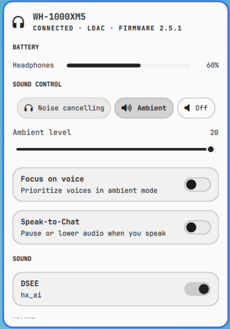

# Sony Headphones for Linux

A native Linux service and command-line controller for Sony headphones that use the Sony | Sound Connect protocol. It publishes live state as JSON and accepts commands through a private Unix socket, so it can be used by any desktop, status bar, script, or automation tool. An optional Omarchy Quattro widget provides a graphical frontend.

> **Hardware alpha:** the complete control path is tested on a WH-1000XM5 running firmware 2.5.1 over MDR v2. Other models may work when they report supported protocol capabilities, but they are not claimed as tested. See the [compatibility matrix](docs/COMPATIBILITY.md).

| Omarchy dark theme | Omarchy light theme |
| --- | --- |
|  |  |

## Features

- Main, left, right, and case battery levels when reported by the device
- Noise cancellation, ambient sound level, and focus on voice
- Speak-to-Chat, DSEE, writable equalizer presets, and connection priority
- Headphone volume normalized to `0–100`
- Capability-gated controls: unsupported features are not displayed
- On-demand RFCOMM control so Sony's phone app can reconnect after the panel closes
- Live Omarchy colors, spacing, controls, and dark/light theme changes

The panel intentionally omits playback controls. Playback commands remain in the version-1 CLI schema for compatibility.

## Install on Arch or Omarchy

The AUR package owns only the native daemon, CLI, user service, documentation, and licenses. Omarchy owns the optional QML plugin checkout.

Install the native companion from the AUR:

```sh
yay -S sony-headphones-linux
systemctl --user enable --now sony-headphones.service
```

Install the optional Omarchy widget separately:

```sh
omarchy plugin add https://github.com/VyomJain6904/sony-headphones-linux.git
omarchy plugin enable io.github.vyomjain6904.sony-headphones --section right
```

Confirm the native service is healthy:

```sh
systemctl --user status sony-headphones.service
sony-headphonesctl status
```

The AUR package is a source build. `makepkg` verifies checksums for the application, libmdr, and fmt sources before building, and CMake is disconnected from dependency downloads during compilation.

## Install from source

Install the build dependencies listed in [Development](docs/DEVELOPMENT.md), then run:

```sh
git clone https://github.com/VyomJain6904/sony-headphones-linux.git
cd sony-headphones-linux
./scripts/build.sh
./scripts/install.sh
systemctl --user enable --now sony-headphones.service
```

`install.sh` writes only to `~/.local/bin` and `~/.config/systemd/user`. It does not install or enable the Omarchy widget. Before writing, it rejects unrelated, modified, linked, or foreign-checkout destinations and records the installed hashes in a private checkout-bound receipt.

For a deterministic build without Bluetooth/libmdr:

```sh
./scripts/build.sh --without-libmdr
./build/native/sony-headphonesd --mock
```

## Use the CLI

```text
sony-headphonesctl status
sony-headphonesctl noise off|anc|ambient
sony-headphonesctl ambient-level 1..20
sony-headphonesctl focus-on-voice on|off
sony-headphonesctl speak-to-chat on|off
sony-headphonesctl dsee on|off
sony-headphonesctl eq-preset <reported-preset>
sony-headphonesctl connection quality|stable
sony-headphonesctl volume 0..100
```

The daemon atomically publishes state at:

```text
${XDG_STATE_HOME:-$HOME/.local/state}/sony-headphones/status.json
```

See the [integration guide](docs/INTEGRATION.md) for Waybar, Polybar, eww, AGS, i3status-rust, Conky, KDE Plasma, GNOME Shell, keybindings, and custom Quickshell configurations.

## Update

Update AUR and Omarchy components independently:

```sh
yay -Syu sony-headphones-linux
systemctl --user restart sony-headphones.service
omarchy plugin update io.github.vyomjain6904.sony-headphones
```

For a receipt-backed source installation, pull the repository, rebuild, reinstall, and restart the service:

```sh
git pull --ff-only
./scripts/build.sh
./scripts/install.sh
systemctl --user restart sony-headphones.service
```

Existing v0.2.2 source installs predate ownership receipts. Immediately after the first `git pull`, run `./scripts/install.sh` once **before rebuilding**; it adopts the old installation only when all three files are byte-identical to the existing build. Then use the normal build/install sequence above. A conflict stops without changing files or the service; inspect, back up, and resolve that path manually rather than forcing installation.

## Uninstall

For an AUR installation:

```sh
systemctl --user disable --now sony-headphones.service
yay -Rns sony-headphones-linux
omarchy plugin remove io.github.vyomjain6904.sony-headphones
```

For a source installation, run the tracked uninstaller from its checkout:

```sh
./scripts/uninstall.sh
omarchy plugin remove io.github.vyomjain6904.sony-headphones
```

The source uninstaller validates the receipt and every recorded hash before disabling the service. It removes only unchanged artifacts installed by the same checkout; a missing receipt, symlink, unrelated file, or modified owned file stops removal. The native uninstaller and package removal preserve private state. Delete it only when the last status and error information is no longer wanted:

```sh
rm -r -- "$HOME/.local/state/sony-headphones"
```

The Omarchy command is optional in every removal path and should be omitted when the widget was not installed.

## Dependencies

Runtime:

- Linux, BlueZ, D-Bus, and `libbluetooth`
- Omarchy Quattro/Quickshell only for the optional widget

Full source builds require CMake 3.31 or newer, a C++20 compiler, Git, `pkg-config`, `jq`, D-Bus and BlueZ development headers, and Node.js for the JavaScript model test. The runtime contains no Python, Electron, telemetry, or network client.

## Safety and limitations

The daemon and CLI run as an unprivileged user. Their state and socket directories are private, and the public state omits the Bluetooth address. Installing an AUR package uses the normal package-manager privileges required to write under `/usr`; the running service itself does not require root, setuid, or a broad D-Bus policy.

The project does not implement firmware flashing, 360 Reality Audio, Sony account/cloud functions, location tracking, factory reset, or a second Quickshell process. Read [SECURITY.md](SECURITY.md) before using real-device write commands.

## Documentation

- [Compatibility evidence](docs/COMPATIBILITY.md)
- [Development and testing](docs/DEVELOPMENT.md)
- [Architecture](docs/ARCHITECTURE.md)
- [Integration examples](docs/INTEGRATION.md)
- [Verification record](docs/VERIFICATION.md)
- [Publishing guide](docs/PUBLISHING.md)
- [Public specification](SPEC.md)
- [Third-party sources and licenses](THIRD_PARTY.md)

## License and affiliation

MIT licensed. This project is independent, unofficial, and is not affiliated with or endorsed by Sony. Sony, Sony | Sound Connect, and product names are trademarks of their respective owners.
